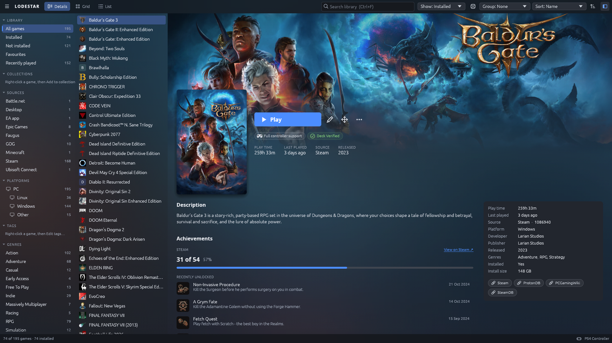
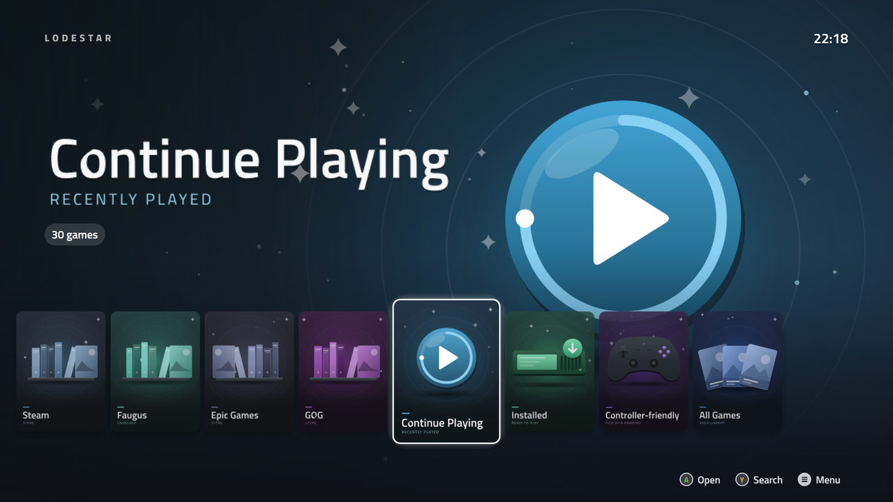
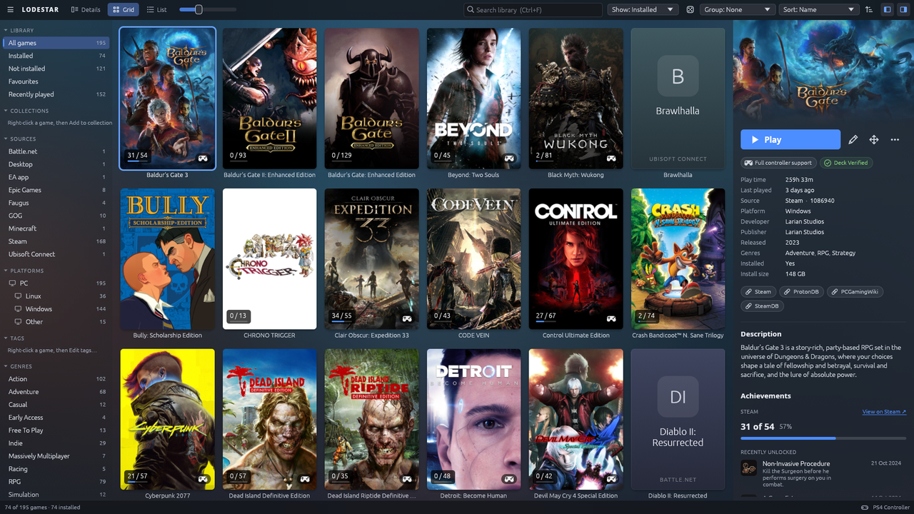
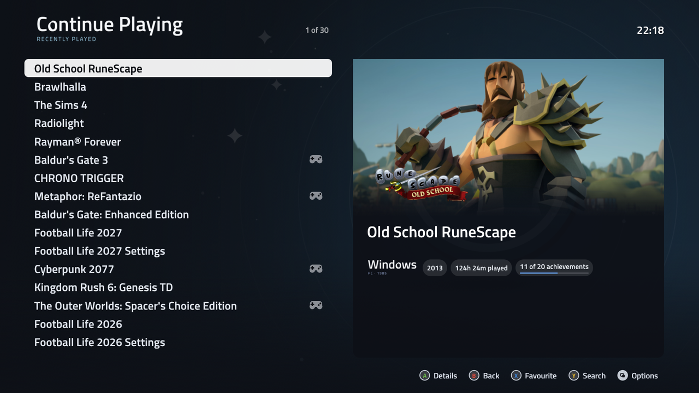
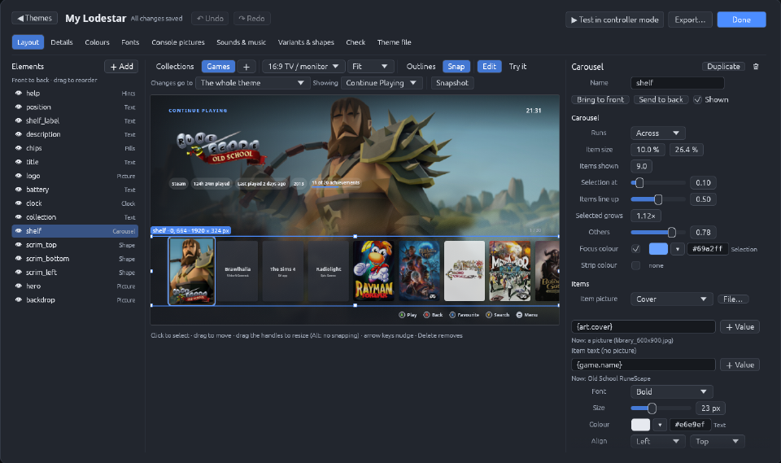
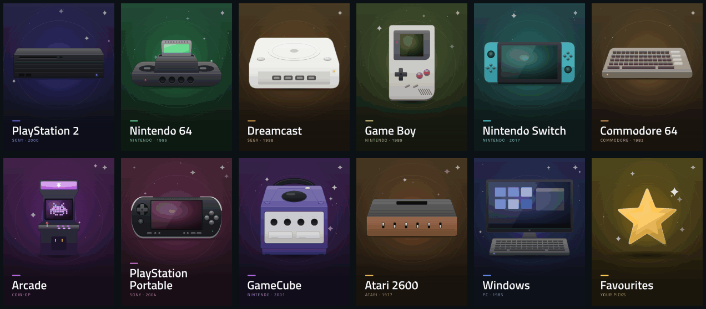

# Lodestar

**A game launcher for your whole library, from desk to couch. Built for Linux.**

[](https://github.com/Dormant-Hero/lodestar/releases/latest)
[](LICENSE)
[](https://discord.gg/vdykSBfcB4)


Lodestar gathers the games from Steam, Heroic, Lutris, your emulators and more into one fast library, with a
Playnite-style desktop mode and a fullscreen controller mode for the couch.

> **Alpha.** Lodestar is early software made by one person with the help of AI. Expect rough edges and bugs, and
> please report what you find in [Issues](https://github.com/Dormant-Hero/lodestar/issues).
>
> **About the console artwork:** the console pictures in the built-in themes are original drawings made for
> Lodestar to demonstrate what themes can do. They are not official artwork and may not look exactly like the real
> consoles. You can replace them, or make a whole theme of your own with the built-in theme creator
> ([THEMES.md](THEMES.md)).

| Desktop mode | Controller mode |
| --- | --- |
|  |  |
|  |  |
|  |  |

- **Finds your games by itself**: Steam (all libraries, playtime, art, non-Steam shortcuts), Heroic (Epic, GOG,
  Amazon, sideloaded), Lutris, Bottles, Faugus, itch, Minecraft launchers, Moonlight, store launchers inside Wine
  prefixes (Battle.net, EA app, Ubisoft Connect …), any `.desktop` game entry, your ROM folders and your own RomM
  server. Shortcuts that point into another launcher are merged, not duplicated.
- **Desktop mode**: explorer sidebar, cover grid, list and details views, search, filters, grouping, sorting,
  collections, favourites, tags, statistics and full game editing.
- **Controller mode**: fullscreen and navigated entirely with a gamepad, with an in-game menu on your controller's
  menu button.
- **Emulation**: finds installed emulators (Flatpak, AppImage, portable, native), recognises ROMs, checks BIOS files,
  and lets you pick the emulator per console or per game.
- **Achievements**: Steam achievements from the Steam app's own files, RetroAchievements with your own Web API key.
- **Themes**: built-in themes with Lodestar's own console artwork, a visual **theme creator** for making your
  own, and Playnite themes imported on your computer. Making themes: [THEMES.md](THEMES.md).
- **Launching done properly**: Steam-style launch options, game options (Gamescope, MangoHud, GameMode …), and
  store launchers kept out of sight while their game runs.
- **Light**: one self-contained binary. SQLite, image decoding, TLS, fonts and controller input are built in. It
  needs nothing but a normal Linux desktop (graphics driver, Wayland or X11, udev). Idle = no CPU.

## Install

**The easy way:** download `Lodestar-<version>-x86_64.AppImage` from
[Releases](https://github.com/Dormant-Hero/lodestar/releases), make it executable (right-click → Properties →
Allow executing, or `chmod +x`) and open it. It runs on any distro with glibc 2.39 or newer (Fedora 40+,
Ubuntu 24.04+, Arch, …). [Gear Lever](https://flathub.org/apps/it.mijorus.gearlever) adds it to your app menu.

**Updates:** the AppImage keeps itself up to date. Once a day Lodestar asks GitHub whether a newer release is out
(nothing else is sent) and offers to install it: it shows what's new, downloads the new AppImage, checks it against
the release's checksum and puts it in place of the old one, then restarts when you say so. You can switch the daily
check off (Settings → General → Updates), check yourself with menu → Check for updates…, or skip a version. Gear
Lever and other AppImage updaters can update it too. Installed with `install.sh`, Lodestar only tells you that a
new version is out.

**From source** (Rust stable, see [Build](#build)):

```bash
./install.sh
```

This puts `lodestar` in `~/.local/bin` and adds two menu entries: **Lodestar** and **Lodestar Controller Mode**.

```bash
./install.sh --session
```

also adds **Lodestar (Controller)** to the login screen's session list (asks for sudo), so you can boot straight
into controller mode. It runs inside `gamescope` when it is installed.

```bash
./install.sh --autostart
```

starts controller mode when you log in. `./install.sh --uninstall` removes everything it installed (your library
and settings stay in `~/.local/share/lodestar` and `~/.config/lodestar`).

### Building the AppImage

```bash
APPIMAGETOOL=~/.local/bin/appimagetool ./packaging/make-appimage.sh
```

builds `dist/Lodestar-<version>-x86_64.AppImage` and `dist/Lodestar-<version>-x86_64.AppImage.zsync` (needs
[appimagetool](https://github.com/AppImage/appimagetool)). To publish a release, attach **both** files to a GitHub
release named after the tag (`v<version>`) and publish it as a normal release, not a pre-release: Lodestar's
updater and AppImage updaters only look at the newest normal release. Add the version's `<release>` to
`packaging/io.github.Dormant_Hero.Lodestar.metainfo.xml` first.

## Use

| | |
| --- | --- |
| `lodestar` | desktop mode (or whatever `start_mode` says in the config) |
| `lodestar --controller` | controller mode, fullscreen |
| `lodestar --controller --windowed` | controller mode in a window |
| `lodestar --scan` | rescan all launchers and print what was found |
| `lodestar --list` | print the library |
| `lodestar --launch NAME [--direct] [--stop-after SECS] [--dry-run]` | launch one game from a terminal and report what happens (troubleshooting) |
| `lodestar --import-playnite-theme PATH` | import a Playnite theme (`.pthm` package or theme folder) |

The Guide (home) button on a controller switches desktop mode to controller mode; the quick menu (Start) in
controller mode switches back.

### Controller

| Button | Does |
| --- | --- |
| D-pad / left stick | move (hold to repeat) |
| A | open / play |
| B | back |
| X | favourite |
| Y | search |
| LB / RB | page |
| LT / RT | previous / next letter |
| Start | quick menu (desktop mode, rescan, theme, swap A/B, fullscreen, quit) |
| Select | game options (launch options, hide, sort…) |

Keyboard works too: arrows, Enter, Esc, Tab, F1, F, `/`, PgUp/PgDn, Home/End.

### Launch options

Right-click a game → **Launch options…**

- **Launch options**: `VAR=value` words become environment variables, words before `%command%` wrap the game,
  words after it (or everything, if there is no `%command%`) are passed to the game.
- **Custom command**: replaces the launcher's command. **Run without Steam's launch options** (Steam games) and
  **Run directly with umu-run** (Faugus games) fill in the command the launcher itself would run, so only your
  options apply.
- Steam can't be wrapped from outside: for a Steam game launched through Steam, Lodestar can only add arguments.
  Use the custom command for wrappers or variables.

### Themes

Settings → Appearance picks the desktop theme (colours and fonts) and the controller theme (full layout).
Lodestar comes with its own themes; Add-ons → Browse themes installs community themes from Playnite's theme list,
and Add-ons → Desktop themes / Controller themes → **Import…** converts a Playnite theme package or folder you
already have.

**Make your own:** menu → **Theme creator** starts from any theme and lets you change it while you watch, then
share it as a `.zip` ([docs/theme-creator.md](docs/theme-creator.md)). Themes live in
`~/.local/share/lodestar/themes/<name>/theme.toml` and can also be edited by hand: [THEMES.md](THEMES.md).

### Art and descriptions

Local art is used first (Steam's library cache, launcher caches, icons). Missing Steam covers and descriptions are
fetched from the Steam store once per game (Settings → Metadata, on by default). For non-Steam games, add a free
[SteamGridDB](https://www.steamgriddb.com/profile/preferences/api) API key there.

## Files

| | |
| --- | --- |
| `~/.config/lodestar/config.toml` | settings |
| `~/.local/share/lodestar/library.db` | library (SQLite) |
| `~/.local/share/lodestar/themes/` | your own and imported themes |
| `~/.local/share/lodestar/art/` | downloaded art |
| `~/.cache/lodestar/` | thumbnails, game logs |

Set `LODESTAR_HOME=/some/dir` to keep config, library and cache in one separate folder (handy for testing).

## Build

Rust stable:

```bash
cargo build --release
```

Tests: `cargo test --release`. A map of the code: [ARCHITECTURE.md](ARCHITECTURE.md); making themes:
[THEMES.md](THEMES.md).

## Credits and licences

Lodestar is built on the work of many open-source projects and game-data communities: Playnite (its platform list,
ROM database and theme defaults, MIT), ES-DE, libretro, No-Intro, Redump, GameTDB, egui and about 250 Rust
libraries. [THIRD_PARTY_NOTICES.md](THIRD_PARTY_NOTICES.md) lists every one with its licence and the full licence
texts; the same is in the app (menu → About Lodestar → Credits) and is installed to
`~/.local/share/doc/lodestar/` (the AppImage carries it in `usr/share/doc/lodestar/`).

After changing dependencies, regenerate it with `python3 -I tools/gen-third-party-notices.py` (offline; a test fails
while it is out of date).

Game names, console names, store names and logos are trademarks of their owners. Lodestar is an independent
project: it is not affiliated with or endorsed by Playnite, ES-DE, RetroAchievements, Valve or any store, console
maker or game publisher. It can import Playnite themes; those themes belong to their authors and are downloaded
from them by you, never shipped with Lodestar.

## Community and feedback

- **Chat, questions, sharing themes:** join the [Lodestar Discord](https://discord.gg/vdykSBfcB4).
- **Bugs and suggestions:** [Issues](https://github.com/Dormant-Hero/lodestar/issues), using the bug report or
  suggestion template.

Lodestar doesn't accept pull requests; see [CONTRIBUTING.md](CONTRIBUTING.md).

## Thanks

Thanks to **Laguna** for testing Lodestar from its earliest builds, finding many of its bugs and suggesting a lot of
what it does today.

## How it was made

Lodestar was written with the help of AI coding tools (Claude), directed, tested and reviewed by its author.

## Licence

Lodestar is open source under the [MIT licence](LICENSE): use it, change it, fork it and share it, as long as the
licence and copyright notice stay with it. Parts it includes from other projects keep their own licences; see
[THIRD_PARTY_NOTICES.md](THIRD_PARTY_NOTICES.md).
