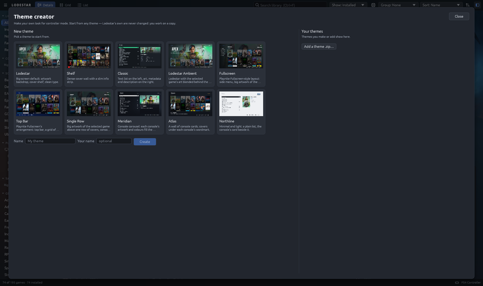
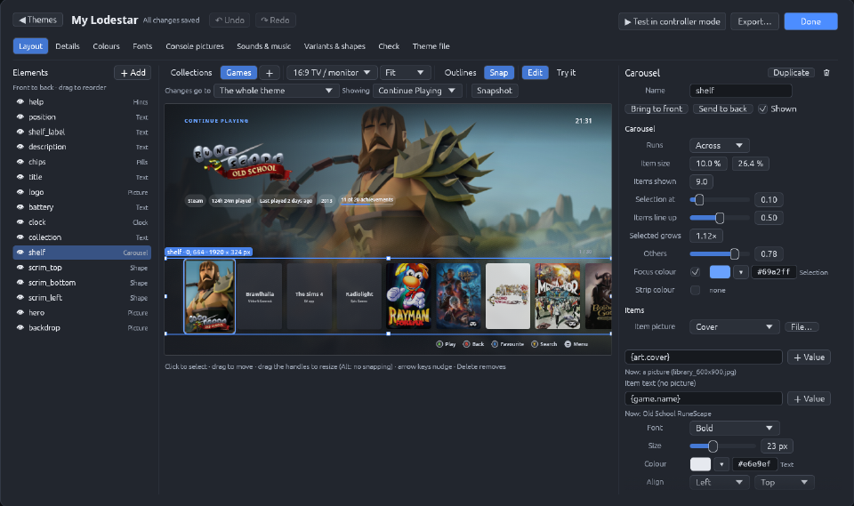
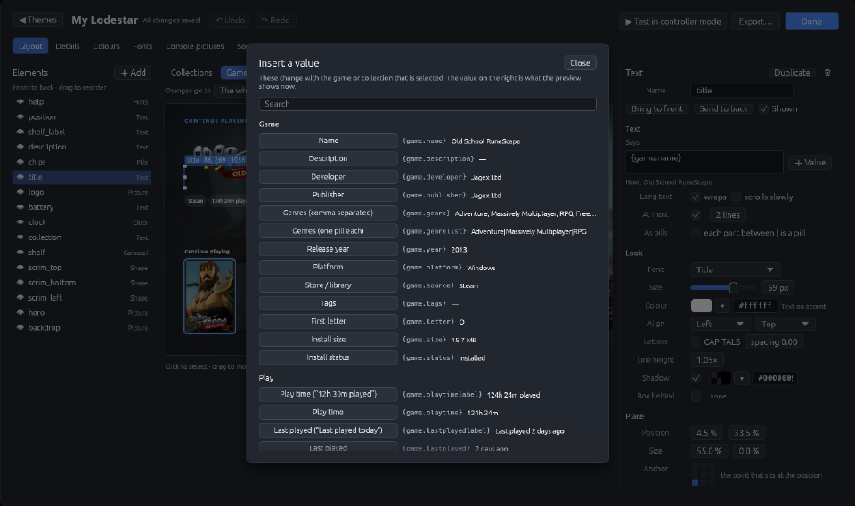
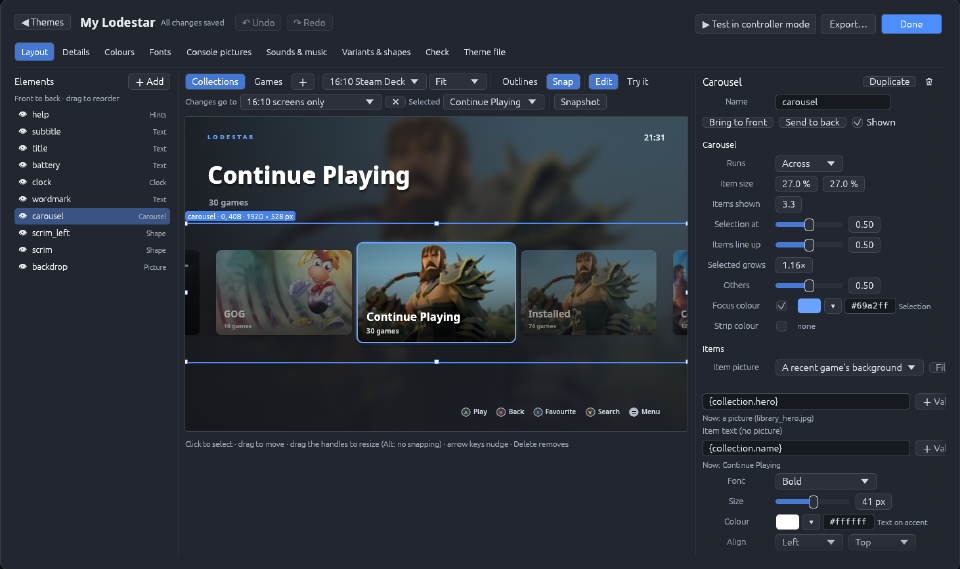
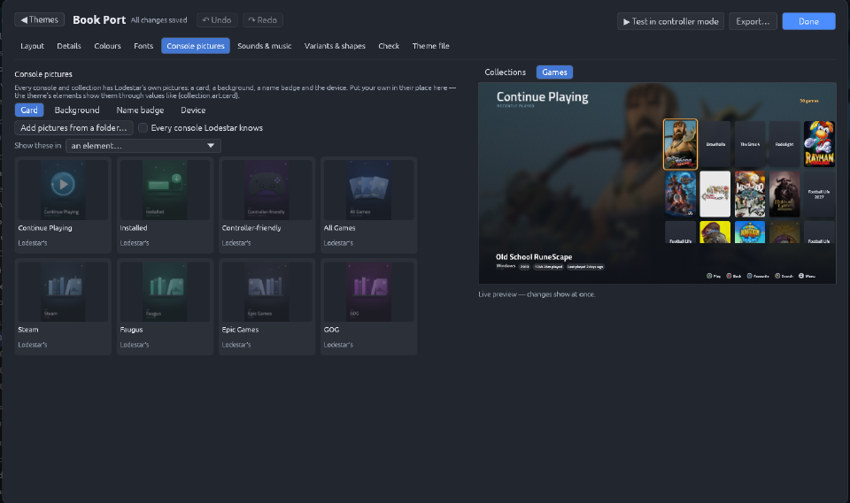
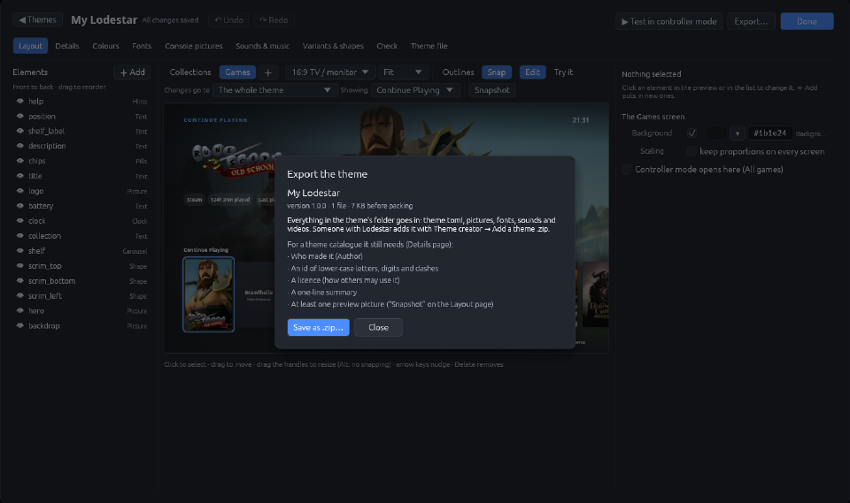

# The theme creator

Make your own look for Lodestar's controller mode — the full-screen, gamepad-friendly mode —
without writing a line of code. You work on the real thing: the preview is Lodestar's own
renderer drawing your library, so what you see is what you get on the TV or the Steam Deck.

Open it from **Menu → Theme creator…**, or **Add-ons → Controller themes → Create theme…**
(the ✎ button on one of your themes opens that theme).



## Starting

* **New theme** — pick any theme to start from (Lodestar's own or one you have) and give it a
  name. Lodestar makes a copy in its themes folder; the original is never changed.
* **Your themes** — continue with a theme you made or added. (Themes imported from Playnite
  offer *Edit a copy*: changing their Playnite options later would re-import them over your
  changes.)
* **Add a theme .zip…** — a Lodestar theme someone shared with you.

Everything is saved automatically a moment after each change. **Undo** / **Redo** (Ctrl+Z /
Ctrl+Shift+Z) go back as far as you like while the creator is open.

## The Layout page



* **Screens** — *Start page* (if the theme has one), *Collections*, *Games* and *Game page*.
  **＋** adds a game page or a start page the theme doesn't have yet.
* **Elements** (left) — everything on the screen, front to back. Drag a row to put it in
  front of or behind others; the eye hides an element; parts inside a stack and the parts drawn
  over every item of a list are listed under it. **＋ Add** has every kind of element, each
  starting with a sensible look in the theme's colours:
  pictures (background art, cover, logo, a picture file, a video), text (game title, any text,
  description, pills for genres, dates), shapes (panel, fade, progress bar, stack), lists
  (carousel, wheel, grid, text list, cover rows, navigation rail) and extras (stars, badges,
  clock, battery, button hints). *This screen's background* sets a picture, a video or the
  game's art behind everything in one go.
* **Preview** (middle) — click an element to select it, drag it to move it, drag the white
  handles to resize it. Edges and centres snap to the screen and to other elements (pink guide
  lines); hold **Alt** to place freely. Arrow keys nudge the selection (Shift: more), Delete
  removes it, Ctrl+D duplicates it. **Outlines** shows every element's box.
  **Try it** turns the preview into controller mode: arrow keys move through the list, Enter
  opens a collection or a game, Backspace goes back — focus animations and transitions play.
* **Screen shape and size** — 16:9 (TV, monitor), 16:10 (Steam Deck), 4:3 and 21:9, at the
  pixel sizes people have; *Fit* draws it as sharp as the window allows.
* **Showing** — which collection the Games screen shows, from your own library.
* **Inspector** (right) — every setting of the selected element: place and size (in % of the
  screen, with an anchor picker), colours (pick a palette colour or any other), fonts, text
  with **＋ Value**, pictures (the game's art or a file — files are copied into the theme),
  list settings, when it shows, motion, and **Advanced: this element as TOML** for anything
  else. Settings Lodestar doesn't know are kept and shown there.

### Values



Text and pictures can show values of the selected game or collection: `{game.name}`,
`{art.cover}`, `{collection.countlabel}`, `{game.achievements}` … **＋ Value** lists them all in
plain words, with what each one shows right now in the preview, so you never have to remember
a name. Under a text field, *Now:* shows the text as it will read.

**When it shows** makes an element appear only when a value is there ("only when the game
has a logo"), only when it's missing, or on a condition like `{game.year} > 2010`.

### Changes for one variant, screen shape or console

**Changes go to** above the preview decides where a change lands:

* **The whole theme** — the usual.
* **Variant “Grid” only** — a variant is another layout players pick in Settings → Visuals →
  Theme variant.
* **16:10 screens only** — a layout used on its own on screens of that shape. Pick the
  shape in the preview's screen menu first; the Steam Deck is 16:10.
* **PlayStation 2 only** — a look for one console or collection (another background, another
  colour). The preview shows that console.

Elements changed there show ● in the elements list, and the inspector offers to undo those
changes. A variant, shape or console can change any setting of an element, show or hide one;
an element only one variant needs is added hidden to the theme and shown in that variant (the
creator does this for you when you add an element while a variant is chosen).



## The other pages

* **Details** — name, author, version, a one-line summary and a description; for sharing
  (optional): an id, the licence, tags and up to four preview pictures (“Snapshot” above the preview
  keeps the current screen as one).
* **Colours** — the palette (controller-mode menus and the desktop use it too; elements drawn
  in a palette colour change with it), and **colour schemes**: other sets of colours players
  pick in Settings → Visuals → Theme colours (controller mode) or Settings → Appearance
  (desktop). *＋ Light version* gives a good start.
* **Fonts** — the theme's fonts by name (regular, bold, title and your own names): the fonts
  that come with Lodestar, fonts of the computer, or a font file you add (copied into the
  theme so it travels with it).
* **Console pictures** — every console and collection already has Lodestar's own pictures: a
  card, a background, a name badge and the device. Put your own in their place, one console at a
  time (click its picture) or **Add pictures from a folder…**: files named the usual way —
  `ps2.png`, `snes.jpg`, `megadrive.png`, `Nintendo 64.png`, `sony_playstation2.png`,
  `steam.png`, `favorites.png` — are matched for you, and the ones it couldn't match are listed
  so you can pick the console. **Show these in** points a picture element or a list's item
  pictures at them (`{collection.art.card}` and friends). They are saved as
  `[collection_art.<console>]` in the theme.

  

* **Sounds & music** — navigation sounds and background music (players turn them on in
  controller-mode settings).
* **Variants & shapes** — make, rename and remove variants, layouts for screen shapes and
  console looks, and jump to editing them.
* **Check** — what would stop the theme working, what looks like a mistake (a misspelled
  value, a missing picture, an element off the screen, two elements with the same name), in
  plain words, with *Show* to go to the element.
* **Theme file** — the whole `theme.toml`, for anything the pages don't cover.

## Testing and sharing

* **▶ Test in controller mode** makes the theme your controller theme and switches to
  controller mode. Come back with Menu → Switch to desktop mode; the creator is still open.
* **Export…** saves the theme as a `.zip` (the theme's folder: `theme.toml`, pictures, fonts,
  sounds, videos). It says what a theme catalogue would still need.



Adding a shared .zip never runs anything from it: Lodestar checks its size, unpacks only
plain files inside the theme's folder (no paths leading outside it), needs a `theme.toml` it
can read, removes execute permissions, and adds it as a new theme next to yours — it never
replaces one.

### Sharing details in `theme.toml`

All optional; the creator fills them in on the Details page. A catalogue can list a theme from
these alone:

```toml
[theme]
name = "Night Shelf"
author = "Marko"
version = "1.2.0"            # major.minor.patch
id = "marko-night-shelf"     # stable: lower-case letters, digits, dashes
summary = "Big covers on a dark wall"
description = "A longer text…"
license = "CC-BY-4.0"        # or "All rights reserved", "MIT" … (`licence` works too)
tags = ["dark", "grid", "handheld"]
previews = ["previews/games.png", "previews/collections.png"]
made_with = "0.17.0"         # written by the creator on every save
needs = "0.17"               # the oldest Lodestar it works with
```

### Colour schemes in `theme.toml`

```toml
[color_schemes.light]
label = "Light"
palette = { dark = false, background = "#eef0f4", text = "#1b1e24" }
swap = { "#15171c" = "#ffffff" }   # optional: other colours to replace
```

A scheme replaces the palette colours it names; every colour in the theme's screens that is
the same as a palette colour that changed follows it (keeping its own transparency). `swap`
replaces any other colour.

## Coming from another frontend?

The ideas carry over; the names differ. If you made themes elsewhere, this is where to find
things in Lodestar (porting your own theme by hand is quick: start from the Lodestar theme
closest to yours, add your pictures — console pictures by folder — and fonts, then move
things into place on the preview).

| You know it as | In Lodestar |
|---|---|
| System view, platform wheel, the "systems" screen (EmulationStation family, Big Box platform views, RetroFE's collection menu, a Pegasus collection list) | The **Collections** screen |
| Game list / gamelist view, game wheel (EmulationStation family, Big Box game views, Attract-Mode layouts) | The **Games** screen |
| Game details / info panel (Playnite's GameDetails view, Big Box's details view) | The **Game page** (optional) |
| A start page with rows (Playnite fullscreen) | The **Start page** (optional), with **Cover rows** and a **Navigation rail** |
| Carousel, wheel, textlist, grid, list box, menu | **Carousel** (across, down, on a curve, wheel), **Grid**, **Text list**, **Cover rows** |
| Image / artwork / reloadable image bound to game media | **Picture** with a value like `{art.cover}`, `{art.hero}`, `{art.logo}` |
| Text with metadata, magic tokens (`[Title]`), bindings (`{Binding Name}`), `api.currentGame.title` | **Text** with values like `{game.name}`, `{game.developer}`, `{game.year}` |
| Rating stars, date/time, clock, help/button prompts, badges | **Star rating**, **Date** / **Clock**, **Button hints**, **Badges** |
| Video / snap | **Video** (a picture element with a video file) |
| Per-system art (logos, backgrounds named after systems) | **Console pictures** (`{collection.art.card}`, `.hero`, `.mark`, `.device`; a folder of `ps2.png`, `snes.png` … is matched for you) |
| Per-system overrides, per-collection layouts | **Console looks** ("PlayStation 2 only") |
| Variants, layout options | **Variants** (Settings → Visuals → Theme variant) |
| Colour schemes, colour options | **Colour schemes** (Settings → Visuals → Theme colours) |
| Aspect-ratio layouts (16:9, 16:10, 4:3) | **Screen shapes** (used on their own on such screens), or *keep proportions* to scale one layout |
| Font size options | Players have Settings → Visuals → Text size; a theme can add a "Compact" or "Large" **variant** |
| Transitions, animations, storyboards | **Motion**: when an item gets / loses the focus, when an element appears / goes |
| Theme fonts, sounds, music | **Fonts**, **Sounds & music** (files copied into the theme) |
| `theme.xml`, `theme.qml`, `layout.nut`, `layout.xml`, XAML views | One `theme.toml` (the **Theme file** page shows it) |

Positions and sizes are fractions of the screen (shown as % in the creator), anchors pick
which point of an element sits at its position, and text sizes are a fraction of the screen
height — the same ideas as most frontends' layout files.
